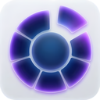

<p align="center">
  
</p>

<h1 align="center">Cue</h1>

<p align="center">
  <strong>A fluid, radial productivity launcher for macOS.</strong>
</p>

<p align="center">
  
  
  
  
</p>

---

## Overview

**Cue** is a modern radial alternative to traditional list-based macOS launchers like Spotlight, Raycast, and Alfred. Instead of scrolling through vertical lists, Cue spawns directly beneath your cursor in a responsive **360° Radial Fan**, giving you immediate, spatial muscle-memory access to applications, system commands, settings, quick calculations, and files.

Built natively in **Swift and SwiftUI**, Cue integrates seamlessly into macOS with frosted glass visuals, spring-based physics, and trackpad haptic feedback.

---

## Features

### 🎯 Radial Fan Interface
- **Cursor-Centric HUD**: Summons instantly at your mouse location with `⌥ Space` (Option + Space).
- **Interactive Wedges**: Annular sectors arranged radially with dynamic wedge counts (4 to 12).
- **Center Hub**: Displays active query, live math evaluation results, or high-res QuickLook file previews.
- **Fluid Micro-Interactions**: Spring physics, smooth expansions, and trackpad haptic clicks as you move between wedges.
- **Overlay Windowing**: Borderless `NSPanel` floating overlay that works over full-screen apps and games without stealing focus.

### 🔍 Search & Engine Providers
- **App Launcher**: Instant indexing of system and user apps with acronym matching (e.g. `fcp` for *Final Cut Pro*), habit learning, and single-key result cycling.
- **System Commands**: Quick access to *Sleep*, *Restart*, *Shut Down*, *Lock Screen*, *Empty Trash*, and *Toggle Dark Mode*.
- **System Settings**: 20+ direct deep links into macOS Settings panes (Wi-Fi, Bluetooth, Displays, Sound, Wallpaper, etc.).
- **Live Calculator & Currency**: Embedded JavaScriptCore engine for instant arithmetic expressions and currency conversions.
- **Spotlight File Search**: Fast scoped file search across Desktop, Documents, and Downloads with QuickLook thumbnail generation.

### 🎨 Theming & Personalization
- **Curated Presets**: Includes 8+ built-in themes: *Glass*, *Midnight*, *Neon*, *Catppuccin*, *Dracula*, *Nord*, *Rosé Pine*, and *Tokyo Night*.
- **Dynamic Themes**:
  - *Time of Day*: Automatically shifts accent hues from morning amber to evening violet.
  - *Wallpaper Match*: Samples your current desktop wallpaper's dominant color palette for seamless aesthetic matching.
- **Custom Theme Studio**: Full control over tint hue, saturation, brightness, and accent strokes with real-time preview.
- **Configurable Aesthetics**: Adjust backdrop bleed (frosted glass transparency), wedge counts, and hidden app privacy rules.

---

## Project Structure

```text
Cue/
├── App/                          # Application lifecycle & windowing
│   ├── CueApp.swift              # App entry point, menu bar status item & lifecycle
│   ├── WindowManager.swift       # Custom NSPanel (CuePanel) overlay management
│   └── TriggerManager.swift      # Carbon framework global hotkey registration
├── Models/                       # Core data models & state
│   ├── CueResult.swift           # Unified search result protocol & action types
│   ├── AppResult.swift           # Application search result representation
│   └── CueSettings.swift         # Theme system, presets & user preferences
├── Search/                       # Search coordinator & engine providers
│   ├── AppSearchEngine.swift     # Multi-provider search orchestrator & habit learning
│   ├── AppRegistry.swift         # Installed app discovery, caching & acronym matching
│   ├── CalculatorEngine.swift    # JavaScriptCore math & currency conversion evaluator
│   ├── FileSearchProvider.swift  # Spotlight NSMetadataQuery scoped search
│   ├── SystemCommandProvider.swift # Power & macOS system action handlers
│   └── SystemSettingsProvider.swift # macOS System Settings deep-link router
├── Views/                        # SwiftUI interface components
│   ├── RadialFanView.swift       # Radial fan rendering, wedge math & interactions
│   └── SettingsView.swift        # Preferences UI, theme builder & privacy settings
└── Assets.xcassets/              # App icons, accent color & asset catalog
```

---

## Keyboard Shortcuts

| Shortcut | Action |
| --- | --- |
| `⌥ Space` | Toggle Cue radial fan at cursor |
| `Esc` | Dismiss launcher |
| `Arrow Keys` / `Hover` | Select sector / wedge |
| `Return` | Launch selected item / execute action |
| `Key Tap Cycle` | Cycle between multiple apps sharing the same starting character |

---

## Getting Started

### Prerequisites
- macOS 14.0 (Sonoma) or later
- Xcode 16.0 or later
- Swift 5.9 or later

### Building from Source

1. **Clone the repository:**
   ```bash
   git clone git@github.com:vex-codes/Cue.git
   cd Cue
   ```

2. **Open in Xcode:**
   ```bash
   open Cue.xcodeproj
   ```

3. **Build & Run:**
   - Select the `Cue` scheme.
   - Press `⌘R` to build and run.
   - Alternatively, build via CLI:
     ```bash
     xcodebuild -scheme Cue -destination 'platform=macOS' build
     ```

4. **Grant Permissions:**
   - On first launch, grant Accessibility permissions if prompted to enable the global Carbon hotkey trigger.

---

## License

This project is licensed under the MIT License — see the [LICENSE](LICENSE) file for details.
